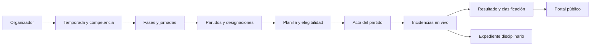
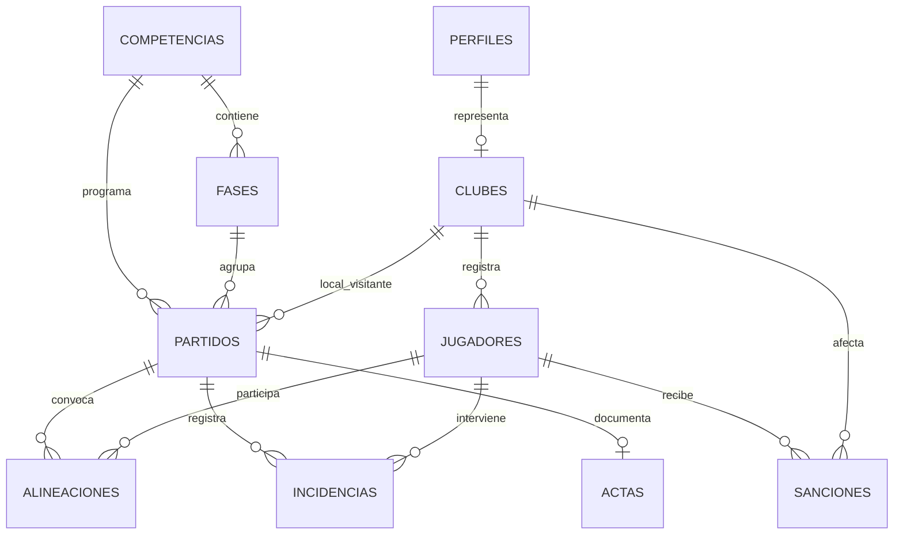
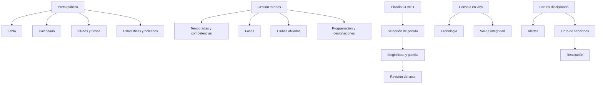
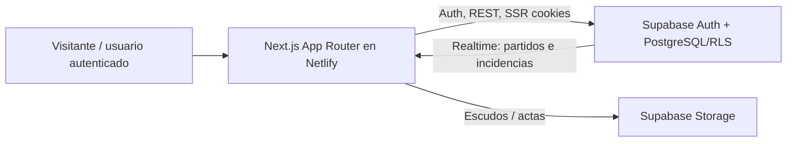

# SRS — SIGEC-LP: Gestión de Competiciones LigaPro

| Metadato | Valor |
|---|---|
| Versión | 1.0 |
| Fecha | 16 de noviembre de 2026 |
| Idioma | Español |
| Estado | Base reconstruida y lista para implementación iterativa |
| Fuente | Solicitud del usuario, ZIP `stitch_ligapro_competition_management_system.zip`, `DESIGN.md` y datos de conexión Supabase facilitados por el usuario |
| Nota de alcance | El SRS original nombrado en la solicitud no estaba en la carpeta. Este documento reconstruye el alcance visible y registra los supuestos. `SKILL (1).md` describe cómo redactar SRS y no prevalece sobre la solicitud explícita de construir la aplicación. |

## Tabla de contenido

1. [Introducción](#1-introducción)
2. [Descripción general](#2-descripción-general)
3. [Resumen del caso](#3-resumen-del-caso)
4. [Reglas de negocio](#4-reglas-de-negocio)
5. [Requisitos funcionales](#5-requisitos-funcionales)
6. [Casos de uso e historias](#6-casos-de-uso-e-historias-de-usuario)
7. [Requisitos de datos](#7-requisitos-de-datos)
8. [Requisitos de interfaz](#8-requisitos-de-interfaz)
9. [Requisitos no funcionales](#9-requisitos-no-funcionales)
10. [Especificación técnica](#10-especificación-técnica)
11. [Plan de implementación](#11-plan-de-implementación)
12. [Plan de pruebas y aceptación](#12-plan-de-pruebas-y-aceptación)
13. [Matriz de trazabilidad](#13-matriz-de-trazabilidad)
14. [Supuestos y preguntas abiertas](#14-supuestos-adoptados-y-preguntas-abiertas)
15. [Apéndices](#15-apéndices)

## 1. Introducción

### 1.1 Propósito

Definir los requisitos para SIGEC-LP, una aplicación web para consultar y administrar competencias de fútbol de LigaPro Ecuador. Este SRS se elaboró con la información disponible porque el archivo SRS nombrado inicialmente no estaba en la carpeta del proyecto.

### 1.2 Alcance

**Incluye:** portal público con tabla, resultados, calendario, fichas, estadísticas y comunicados de muestra; administración de competencias, fases, clubes y programación; selección y revisión de planillas; registro de incidencias en vivo; libro y seguimiento disciplinario; autenticación Supabase y permisos por rol.

**No incluye en esta versión:** conexión real con COMET/FEF, transmisión de vídeo o proveedor VAR, firma electrónica con validez legal, notificaciones externas, pagos/multas, carga masiva de plantillas y publicación automatizada de PDF. Las pantallas explican los puntos de integración pendientes.

### 1.3 Definiciones

| Término | Definición |
|---|---|
| COMET | Plataforma externa de registro federativo referenciada por los diseños. |
| Acta | Registro electrónico del partido, sus alineaciones e incidencias. |
| RLS | Políticas de seguridad por fila de PostgreSQL, aplicadas por Supabase. |
| Fase / jornada | Nivel de organización de una competencia y fecha de partidos correspondiente. |
| Serie | División de competencia (A o B en las pantallas entregadas). |
| GD | Diferencia de goles: goles a favor menos goles en contra. |

### 1.4 Referencias

- Solicitud del usuario para ProyectoLigaPro SOF-3-1.
- ZIP de Stitch y archivo `ligapro_elite_competition_engine/DESIGN.md`.
- Fragmentos de configuración Supabase compartidos por el usuario.
- `SKILL (1).md`: plantilla de SRS; se usa como guía documental, no como límite que impida programar.
- ISO/IEC/IEEE 29148 e IEEE 830 como referencias de organización documental.

### 1.5 Visión general

El documento define actores, procesos, requisitos verificables, 27 pantallas, datos, seguridad, arquitectura, implementación y aceptación. El esquema SQL ejecutable se entrega en [supabase/schema.sql](supabase/schema.sql).

## 2. Descripción general

### 2.1 Perspectiva del producto

Aplicación web Next.js con App Router. Supabase presta Auth, PostgreSQL, RLS, Storage y Realtime. Netlify es el destino previsto para despliegue, que se ejecutará únicamente cuando el usuario lo autorice.

### 2.2 Funciones por módulo

1. **Portal público:** resultados, clasificación, calendario, encuentros, clubes, estadísticas y boletines.
2. **Competiciones:** temporadas, fases, clubes, cumplimiento, partidos y designaciones.
3. **Planilla COMET:** selección de encuentro, consulta de elegibilidad, validación de nóminas y revisión del acta.
4. **Consola en vivo:** reloj de interfaz, marcador, incidencias, cronología, VAR e integridad.
5. **Disciplina:** indicadores, alertas, libro de sanciones y creación de resoluciones.

### 2.3 Actores

| Actor | Descripción | Permisos | Nivel técnico |
|---|---|---|---|
| Visitante público | Consulta contenido publicado. | Lectura de competencias, clubes, calendario, resultados y clasificación pública. | Básico |
| Administrador | Administra cuentas, datos y configuración. | Acceso total a través de políticas RLS. | Intermedio |
| Organizador | Gestiona competencias, fases, clubes y calendario. | CRUD de competencia y programación según políticas. | Intermedio |
| Comisario | Supervisa partido y acta. | Consulta planilla; registra incidencias en encuentros asignados. | Básico |
| Árbitro | Registra decisiones durante el partido. | Registra incidencias en encuentros asignados. | Básico |
| Delegado de club | Mantiene la plantilla de su club. | Gestiona jugadores y alineaciones de su club cuando el rol y vínculo estén asignados. | Básico |
| Comisión disciplinaria | Gestiona resoluciones y seguimiento. | Consulta y modifica sanciones. | Intermedio |

### 2.4 Entorno operativo

Navegadores vigentes de escritorio y móvil; pantallas de 360 px en adelante; conexión HTTPS; horario de presentación `America/Guayaquil` (UTC−5). La base de datos almacena fechas como `timestamptz`.

### 2.5 Restricciones

- La aplicación usa la URL y la clave pública publishable de Supabase. No se usa `service_role` en cliente ni repositorio.
- La autorización se impone en PostgreSQL mediante RLS; ocultar controles en la interfaz no constituye una barrera de seguridad.
- COMET, correo, pagos, VAR y firma digital requieren credenciales y acuerdos externos no entregados.
- Los clubes, marcadores y temporada 2024 que aparecen en el ZIP son datos de demostración.

### 2.6 Supuestos y dependencias

Se adopta fútbol porque los diseños contienen goles, tarjetas, alineaciones, clubes y actas. Se mantienen las divisiones Serie A/B mostradas. Los supuestos detallados se enumeran en la sección 14.

## 3. Resumen del caso

### 3.1 Contexto y problema

Las pantallas describen una plataforma central para mostrar resultados y clasificaciones, organizar fases y programación, validar alineaciones, registrar incidencias y dar seguimiento a sanciones. El objetivo es unificar estos flujos con acceso público de lectura y acceso administrativo protegido.

### 3.2 Objetivos

- Hacer consultables los resultados, calendario, clubes y tabla calculada.
- Mantener las temporadas, fases y partidos en un modelo relacional.
- Restringir cambios operativos por identidad, rol y asignación al partido.
- Registrar incidencias y resoluciones con trazabilidad básica.
- Reutilizar las cinco familias visuales entregadas y completar un producto de al menos 21 pantallas. El alcance definido es de 27.

### 3.3 Interesados

LigaPro y dirección de competiciones; clubes; comisarios y árbitros; comisión disciplinaria; público seguidor; operadores técnicos de Supabase y Netlify.

### 3.4 Procesos clave

## 4. Reglas de negocio

| ID | Regla | Origen | RF relacionados |
|---|---|---|---|
| RN-001 | La tabla solo contabiliza encuentros finalizados de una competencia pública activa o de demostración. | [DERIVADO] | RF-001, RF-002 |
| RN-002 | Se asignarán 3 puntos por victoria, 1 por empate y 0 por derrota. | [SUPUESTO] SUP-002 | RF-001 |
| RN-003 | La tabla ordenará por puntos, diferencia de goles, goles a favor y nombre del club mientras no exista otro reglamento confirmado. | [SUPUESTO] SUP-003 | RF-001 |
| RN-004 | El equipo local y visitante de un partido deben ser distintos. | [DERIVADO] | RF-006 |
| RN-005 | El minuto de una incidencia debe estar entre 0 y 130. | [RECOMENDADO] | RF-011 |
| RN-006 | Solo usuarios de rol árbitro/comisario asignados al partido pueden registrar incidencias; administrador puede hacerlo para soporte. | [RECOMENDADO] | RF-009, RF-011 |
| RN-007 | Un jugador suspendido o no elegible no puede considerarse habilitado para el acta. | [DERIVADO] | RF-010 |
| RN-008 | La app no genera automáticamente una sanción por acumulación de tarjetas hasta que se confirme el reglamento por temporada. | [SUPUESTO] SUP-005 | RF-013, RF-014 |
| RN-009 | Las fichas de temporada 2024 del ZIP se consideran demostrativas y no resultados oficiales actuales. | [SUPUESTO] SUP-006 | RF-001–RF-014 |
| RN-010 | Los datos de cuenta y las actas internas no se exponen al visitante público. | [RECOMENDADO] | RF-009, RF-010, RF-012–RF-014 |

## 5. Requisitos funcionales

### RF-001 — Consultar clasificación pública

| Campo | Detalle |
|---|---|
| Módulo / actor | Portal / visitante |
| Prioridad / origen | Must / [CASO] pantalla Stitch portal; [SUPUESTO] RN-002 y RN-003 |
| Descripción | El sistema deberá mostrar PJ, PG, PE, PP, GF, GC, GD y puntos en orden calculado desde partidos finalizados. |
| Datos / pantallas | competencias, clubes, partidos, `clasificacion_publica`; PAN-001, PAN-006 |
| Aceptación | Dado un partido finalizado, cuando se actualice su marcador, entonces la vista recalculará puntos y posición. Dado un partido programado/en vivo, cuando se consulte la tabla, entonces no sumará sus goles ni puntos. |

### RF-002 — Consultar calendario y resultados

| Campo | Detalle |
|---|---|
| Módulo / actor | Portal / visitante |
| Prioridad / origen | Must / [CASO] portal Stitch |
| Descripción | El sistema deberá presentar partidos por fecha, jornada, fase, sede y estado, y permitir abrir su ficha. |
| Datos / pantallas | partidos, fases, clubes; PAN-001, PAN-007, PAN-008 |
| Aceptación | Dado un partido programado, cuando se muestre el calendario, entonces se mostrarán sede y horario si están definidos. Dado que el visitante solicita la ficha de un partido inexistente, entonces se mostrará un estado sin datos y no un marcador inventado. |

### RF-003 — Consultar clubes y estadísticas

| Campo | Detalle |
|---|---|
| Módulo / actor | Portal / visitante |
| Prioridad / origen | Should / [CASO] portal y DESIGN.md |
| Descripción | El sistema deberá mostrar directorio, ficha básica y estadísticas derivadas de los datos cargados. |
| Datos / pantallas | clubes, partidos, clasificación; PAN-009, PAN-010, PAN-011 |
| Aceptación | Dado un club activo, cuando se abra su ficha, entonces se mostrarán su sigla y sede registrada. Dado que no existan estadísticas de jugadores, entonces no se afirmarán como oficiales cifras de muestra. |

### RF-004 — Consultar boletines

| Campo | Detalle |
|---|---|
| Módulo / actor | Portal / visitante |
| Prioridad / origen | Could / [CASO] panel visual Stitch |
| Descripción | El sistema deberá presentar comunicados publicados de la competencia y su módulo de destino. |
| Datos / pantallas | comunicados; PAN-012 |
| Aceptación | Dado un comunicado publicado, cuando el usuario abra boletines, entonces verá título y resumen. Dado que no haya comunicados configurados, entonces se indicará que no existen publicaciones. |

### RF-005 — Administrar competencias

| Campo | Detalle |
|---|---|
| Módulo / actor | Torneos / administrador, organizador |
| Prioridad / origen | Must / [CASO] pantalla gestión de torneos |
| Descripción | El sistema deberá crear competencias con nombre, temporada, serie, formato y estado inicial borrador. |
| Datos / pantallas | competencias; PAN-002, PAN-013, PAN-014 |
| Aceptación | Dado un nombre y temporada válidos, cuando un organizador guarde, entonces se creará la competencia. Dado un usuario visitante o una serie inválida, entonces no se insertará la competencia. |

### RF-006 — Organizar fases y jornadas

| Campo | Detalle |
|---|---|
| Módulo / actor | Torneos / organizador |
| Prioridad / origen | Must / [CASO] gestión de fases Stitch |
| Descripción | El sistema deberá vincular fases ordenadas a una competencia y mostrar su calendario asociado. |
| Datos / pantallas | fases, competencias, partidos; PAN-015, PAN-018 |
| Aceptación | Dada una competencia existente, cuando se agregue una fase, entonces quedará vinculada y ordenada. Dado un número de orden duplicado, entonces la base de datos rechazará el registro. |

### RF-007 — Consultar y mantener clubes

| Campo | Detalle |
|---|---|
| Módulo / actor | Torneos / administrador, organizador, visitante |
| Prioridad / origen | Must / [CASO] pantallas portal y gestión |
| Descripción | El sistema deberá mantener nombre, sigla, serie, sede, color y estado del club; exponer públicamente solo los clubes activos. |
| Datos / pantallas | clubes; PAN-009, PAN-010, PAN-016, PAN-017 |
| Aceptación | Dado un club activo, cuando se consulte el directorio, entonces aparecerá. Dado un usuario sin rol administrativo que intenta modificarlo, entonces RLS rechazará la operación. |

### RF-008 — Programar encuentros y designaciones

| Campo | Detalle |
|---|---|
| Módulo / actor | Torneos / organizador, comisario |
| Prioridad / origen | Must / [CASO] pantalla panel de torneos |
| Descripción | El sistema deberá programar la jornada, clubes, sede, fecha y estado de partido; la pantalla permitirá revisar designaciones. |
| Datos / pantallas | partidos, fases, clubes, perfiles; PAN-018, PAN-019 |
| Aceptación | Dado dos clubes distintos y fecha válida, cuando el organizador guarde, entonces se creará un partido. Dado el mismo club local y visitante, entonces no se guardará. |

### RF-009 — Autenticar y autorizar usuarios

| Campo | Detalle |
|---|---|
| Módulo / actor | Todos los roles internos |
| Prioridad / origen | Must / [DERIVADO] operaciones administrativas |
| Descripción | El sistema deberá iniciar/cerrar sesión por Supabase Auth y aplicar permisos con el rol persistido en perfiles y RLS. |
| Datos / pantallas | perfiles, auth.users; modal de acceso global |
| Aceptación | Dado correo/contraseña válidos, cuando se inicie sesión, entonces se cargará el perfil y su rol. Dado un token expirado o rol no autorizado, entonces se rechazará la escritura y se mantendrán los datos protegidos. |

### RF-010 — Revisar elegibilidad y planillas

| Campo | Detalle |
|---|---|
| Módulo / actor | COMET / comisario, árbitro, delegado de club |
| Prioridad / origen | Must / [CASO] pantalla de validación de planilla |
| Descripción | El sistema deberá mostrar jugadores del encuentro, dorsal, club, posición y estado local de elegibilidad; advertir cuando no existan nóminas suficientes o haya estados no habilitados. |
| Datos / pantallas | jugadores, alineaciones, partidos; PAN-020, PAN-003, PAN-021 |
| Aceptación | Dado que falten jugadores para formar titulares, cuando se valide, entonces se mostrará el error y no se cerrará el acta. Dado que todos estén habilitados y haya al menos once inscritos por club, entonces se confirmará la validación preliminar. |

### RF-011 — Registrar incidencias durante un partido

| Campo | Detalle |
|---|---|
| Módulo / actor | Consola / árbitro, comisario |
| Prioridad / origen | Must / [CASO] pantalla de consola en vivo |
| Descripción | El sistema deberá registrar tipo, equipo, jugador opcional, minuto y detalle, y actualizar el marcador si el tipo es gol. |
| Datos / pantallas | incidencias, jugadores, clubes, partidos; PAN-004, PAN-023 |
| Aceptación | Dado un partido asignado y minuto entre 0 y 130, cuando se registre un gol, entonces quedará la incidencia y se actualizará el marcador. Dado un minuto fuera de rango o un usuario no asignado/no autorizado, entonces no se guardará. |

### RF-012 — Consultar cronología e integridad VAR

| Campo | Detalle |
|---|---|
| Módulo / actor | Consola / comisario, árbitro, disciplina; público limitado a resultados publicados |
| Prioridad / origen | Should / [CASO] pantalla en vivo y DESIGN.md |
| Descripción | El sistema deberá listar incidencias cronológicamente y distinguir los chequeos VAR guardados manualmente. |
| Datos / pantallas | incidencias, partidos; PAN-023, PAN-024 |
| Aceptación | Dado un evento nuevo, cuando Supabase emita Realtime, entonces la cronología se actualizará. Dado que el proveedor de vídeo no esté conectado, entonces la pantalla indicará que no hay integración audiovisual. |

### RF-013 — Registrar sanciones

| Campo | Detalle |
|---|---|
| Módulo / actor | Disciplina / administrador, comisión disciplinaria |
| Prioridad / origen | Must / [CASO] pantalla sancionatoria |
| Descripción | El sistema deberá registrar jugador, club, infracción, jornadas de suspensión y estado de la resolución. |
| Datos / pantallas | sanciones, jugadores, clubes, incidencias; PAN-005, PAN-026, PAN-027 |
| Aceptación | Dado un jugador cargado y fechas entre 0 y 100, cuando disciplina guarde, entonces se registrará la resolución. Dado un visitante o un usuario de otro rol, entonces RLS rechazará la inserción. |

### RF-014 — Consultar alertas y libro disciplinario

| Campo | Detalle |
|---|---|
| Módulo / actor | Disciplina / comisión, administrador |
| Prioridad / origen | Must / [CASO] pantalla de sanciones Stitch |
| Descripción | El sistema deberá filtrar y presentar resoluciones por jugador, club, infracción y estado, además de resumir pendientes. |
| Datos / pantallas | sanciones; PAN-025, PAN-026 |
| Aceptación | Dado un término coincidente, cuando se busque, entonces se mostrarán solo resoluciones que coincidan. Dado un visitante, entonces no podrá consultar datos internos de disciplina. |

### RF-015 — Revisar y cerrar actas

| Campo | Detalle |
|---|---|
| Módulo / actor | COMET / comisario, árbitro |
| Prioridad / origen | Should / [CASO] pantalla de planilla |
| Descripción | El sistema deberá mostrar el estado del acta, sus verificaciones y acciones de borrador; firma y transmisión se habilitarán cuando exista integración autorizada. |
| Datos / pantallas | actas, alineaciones, partidos; PAN-022 |
| Aceptación | Dado un acta incompleta, cuando se consulte, entonces mostrará verificaciones pendientes. Dado que no se configure firma COMET, cuando se solicite la firma, entonces se informará que la integración no está habilitada y no se afirmará que existe firma legal. |

## 6. Casos de uso e historias de usuario

### 6.1 Casos de uso

| Actor | Casos de uso |
|---|---|
| Visitante | Consultar tabla, partidos, fichas públicas, estadísticas y comunicados. |
| Organizador | Crear temporada, fases, clubes y programación; revisar designaciones. |
| Comisario / árbitro | Seleccionar partido, validar planilla, registrar incidencias y revisar acta. |
| Delegado de club | Consultar jugadores elegibles y mantener su nómina autorizada. |
| Comisión disciplinaria | Emitir y dar seguimiento a resoluciones. |
| Administrador | Asignar roles y operar todos los módulos. |

### 6.2 Historias

| ID | Historia | RF |
|---|---|---|
| HU-001 | Como visitante quiero ver la tabla para conocer la clasificación. | RF-001 |
| HU-002 | Como visitante quiero abrir el calendario para conocer fecha y sede. | RF-002 |
| HU-003 | Como organizador quiero crear una temporada y sus fases para estructurar la competencia. | RF-005, RF-006 |
| HU-004 | Como comisario quiero revisar la elegibilidad para evitar registrar una alineación observada. | RF-010, RF-015 |
| HU-005 | Como árbitro quiero registrar goles y tarjetas para conservar la cronología oficial. | RF-011, RF-012 |
| HU-006 | Como comisión disciplinaria quiero emitir resoluciones para controlar suspensiones. | RF-013, RF-014 |
| HU-007 | Como administrador quiero limitar cada acción al rol para proteger los datos. | RF-009 |

## 7. Requisitos de datos

### 7.1 Modelo conceptual

### 7.2 Diccionario resumido

El esquema completo, restricciones, claves foráneas e índices está en `supabase/schema.sql`.

| Tabla | Campos principales | Tipo / claves | Descripción |
|---|---|---|---|
| perfiles | id, nombre, rol, club_id | UUID PK/FK auth.users; enum | Identidad y rol institucional. |
| competencias | id, nombre, temporada, serie, formato, estado | UUID PK; unique temporada/serie | Temporadas y divisiones. |
| clubes | id, nombre, sigla, serie, estadio, escudo_path, activo | UUID PK; sigla unique | Clubes participantes. |
| fases | id, competencia_id, nombre, orden, jornadas, estado | UUID PK; FK competencia | Fases de competencia. |
| jugadores | id, club_id, nombre, dorsal, posicion, estado_comet | UUID PK; FK club | Plantilla y elegibilidad. |
| partidos | id, competencia_id, fase_id, jornada, clubes, fecha_hora, estado, goles | UUID PK; FKs; check | Programación y resultado. |
| alineaciones | id, partido_id, jugador_id, club_id, titular, estado_validacion | UUID PK; FKs; unique partido/jugador | Jugadores convocados. |
| incidencias | id, partido_id, club_id, jugador_id, minuto, tipo, detalle | UUID PK; FKs; check minuto/tipo | Eventos del partido. |
| actas | id, partido_id, estado, referencia_comet, hash_documento, firmada_at | UUID PK; unique partido | Estado del acta digital. |
| sanciones | id, jugador_id, club_id, infraccion, jornadas_suspension, multa, estado | UUID PK; FKs; check | Resoluciones disciplinarias. |
| comunicados | id, titulo, categoria, resumen, estado, publicado_at | UUID PK; FK autor | Publicaciones visibles solo al estar publicadas. |

### 7.3 Estados

- Competencia: borrador → activa → cerrada; `demo` identifica el catálogo ilustrativo.
- Partido: programado → en_vivo → finalizado; también suspendido o cancelado.
- Acta: borrador → validada → firmada → bloqueada → transmitida. Firma/transmisión dependen de integración externa.
- Sanción: pendiente → notificada → cumplida; apelada o anulada como estados alternos.

### 7.4 Consultas e indicadores

Clasificación por serie; partidos por jornada/estado; goles derivados de resultados; cantidad de incidencias; sanciones pendientes y cumplidas. Las estadísticas de goleadores y tarjetas requieren que se carguen eventos/jugadores oficiales.

### 7.5 Semilla y migración

`supabase/schema.sql` crea el esquema, RLS, vistas, trigger de perfiles, buckets y una competencia/clubes/partidos etiquetados `DEMO`, basados en Stitch. No crea usuarios ni contraseñas. La sustitución de la semilla por datos oficiales debe hacerse antes de abrir datos de producción.

## 8. Requisitos de interfaz

### 8.1 Inventario de pantallas — 27 pantallas

| PAN | Pantalla | Rol | RF |
|---|---|---|---|
| PAN-001 | Portal público / inicio | Público | RF-001–004 |
| PAN-002 | Resumen de torneos | Organizador | RF-005–008 |
| PAN-003 | Validación de planilla COMET | Comisario, árbitro | RF-010, RF-015 |
| PAN-004 | Consola en vivo | Árbitro, comisario | RF-011, RF-012 |
| PAN-005 | Resumen disciplinario | Disciplina, administrador | RF-013, RF-014 |
| PAN-006 | Tabla pública | Público | RF-001 |
| PAN-007 | Calendario público | Público | RF-002 |
| PAN-008 | Detalle del partido | Público | RF-002, RF-012 |
| PAN-009 | Directorio público de clubes | Público | RF-003 |
| PAN-010 | Ficha pública de club | Público | RF-003 |
| PAN-011 | Estadísticas de competencia | Público | RF-003 |
| PAN-012 | Boletines oficiales | Público | RF-004 |
| PAN-013 | Lista de temporadas | Organizador | RF-005 |
| PAN-014 | Crear competencia | Organizador | RF-005 |
| PAN-015 | Fases y jornadas | Organizador | RF-006 |
| PAN-016 | Clubes afiliados | Organizador | RF-007 |
| PAN-017 | Expediente de club | Organizador | RF-007 |
| PAN-018 | Programación administrativa | Organizador, comisario | RF-008 |
| PAN-019 | Designaciones arbitrales | Organizador | RF-008 |
| PAN-020 | Selección de partido para planilla | Comisario, árbitro | RF-010 |
| PAN-021 | Elegibilidad de jugadores | Comisario, árbitro, delegado | RF-010 |
| PAN-022 | Revisión y cierre de acta | Comisario, árbitro | RF-015 |
| PAN-023 | Cronología de incidencias | Comisario, árbitro | RF-011, RF-012 |
| PAN-024 | VAR e integridad | Comisario, árbitro | RF-012 |
| PAN-025 | Alertas disciplinarias | Disciplina | RF-014 |
| PAN-026 | Libro de sanciones | Disciplina, administrador | RF-013, RF-014 |
| PAN-027 | Nueva resolución disciplinaria | Disciplina | RF-013 |

### 8.2 Navegación

### 8.3 Lineamientos UX/UI

Basado en Stitch: navy `#0B1D3A`, oro `#D4AF37`/`#FFD65A`, porcelana `#F4F5F7`, Inter, bordes de 4–6 px, tablas compactas, marcadores grandes, estados codificados por texto y color. Navegación responsive: lateral en escritorio, barra desplazable en móvil. Controles táctiles de al menos 44 px; foco visible y etiquetas asociadas.

### 8.4 Interfaces externas

Supabase Auth/Data API/Storage/Realtime configurado. COMET/FEF, mensajería, pagos, transmisión audiovisual y proveedor VAR no integrados; requieren endpoints, claves y autorización de LigaPro.

## 9. Requisitos no funcionales

| ID | Categoría | Requisito medible | Verificación | Prioridad |
|---|---|---|---|---|
| RNF-001 | Rendimiento | La vista inicial cargará contenido útil en ≤3 s con caché caliente y red de 10 Mbps. | Lighthouse | Should |
| RNF-002 | Rendimiento | Consultas públicas de calendario y tabla responderán en ≤2 s para 500 partidos y 500 clubes. | Prueba de carga | Should |
| RNF-003 | Seguridad | Todas las tablas de `public` activarán RLS y todas las escrituras internas se probarán por rol. | SQL + pruebas de políticas | Must |
| RNF-004 | Seguridad | Ningún secreto `service_role` estará en variables `NEXT_PUBLIC_*`, cliente ni repositorio. | Revisión de bundle/config | Must |
| RNF-005 | Privacidad | El público no podrá consultar perfiles, actas privadas, sanciones ni alineaciones internas. | Prueba anon y autenticada | Must |
| RNF-006 | Usabilidad | Las tareas de consulta de tabla y calendario se alcanzarán en máximo 2 acciones desde inicio. | Prueba moderada | Should |
| RNF-007 | Accesibilidad | Todo control será operable por teclado y tendrá foco visible; contraste de texto normal ≥4.5:1. | WCAG contrast + teclado | Should |
| RNF-008 | Disponibilidad | La interfaz mostrará un estado de error/reintento en ≤5 s si Supabase no responde. | Simulación de red | Should |
| RNF-009 | Compatibilidad | Interfaz funcional desde 360 px hasta 1920 px, con tablas desplazables en móvil. | Matriz responsive | Must |
| RNF-010 | Mantenibilidad | Las tablas, permisos y validaciones de base se desplegarán desde un único script SQL versionado. | Revisión de migración | Should |
| RNF-011 | Escalabilidad | Índices cubren las búsquedas por temporada, fecha, club, jornada, partido y estado disciplinario. | `EXPLAIN ANALYZE` | Should |
| RNF-012 | Localización | Interfaz en español, fechas en `es-EC`, zona `America/Guayaquil`, moneda USD si se habilitan multas. | Prueba regional | Must |

## 10. Especificación técnica

### 10.1 Arquitectura

### 10.2 Stitch: sistema visual y assets

- Mantener los colores navy/oro, Inter, tablas compactas, líneas de calificación y chips de estado del `DESIGN.md`.
- Componentes: navegación lateral/subnavegación, tabla, tarjeta de partido, tablero de marcador, formulario, alertas, paneles y estados vacíos/carga/error.
- Pantallas: PAN-001 portal de resultados; PAN-002 consola administrativa; PAN-003 validación de acta; PAN-004 marcador en vivo; PAN-005 disciplina. Las PAN-006–027 extienden esos cinco grupos para completar 27 vistas de proyecto.
- Prompts de Stitch por familia:
  - PAN-001/006–012: “Diseña una vista pública LigaPro con navy #0B1D3A, oro #FFD65A e Inter; presenta resultados, tabla legible, filtros de fase, clubes y navegación móvil.”
  - PAN-002/013–019: “Diseña un panel administrativo de competencias de alta densidad, con temporada, fases, clubes, estados de cumplimiento y programación de partidos.”
  - PAN-003/020–022: “Diseña una planilla digital para revisar alineaciones, estado COMET, advertencias, checklist del acta y acciones de borrador.”
  - PAN-004/023–024: “Diseña una consola arbitral táctil con marcador navy, reloj, botones de incidencia, cronología y estado VAR.”
  - PAN-005/025–027: “Diseña un escritorio disciplinario con alertas, sanciones, búsqueda y formulario de resolución.”
- Assets: escudo institucional en SVG/PNG, favicon SVG e insignias de clubes aportados por LigaPro. El ZIP solo contiene capturas/código de referencia; no contiene logos oficiales reutilizables.
- Las capturas y HTML originales se conservan en `design-reference/`.

### 10.3 Supabase: backend

- Script ejecutable: [supabase/schema.sql](supabase/schema.sql). Define enum de roles, 11 tablas, claves foráneas, constraints, índices, trigger `updated_at`, trigger de perfil al registrar Auth, vista de clasificación, RLS, Realtime y buckets `club-escudos` (público, imágenes ≤2 MB) y `actas-comet` (privado, PDF/imagen ≤10 MB).
- Auth: correo/contraseña mediante Supabase Auth. Crear usuario inicial desde Dashboard; `perfiles.rol` comienza como `publico`. El primer administrador debe promoverse desde SQL Editor usando la cuenta que ya se creó.
- RLS aplicada a `competencias`, `clubes`, `perfiles`, `fases`, `jugadores`, `partidos`, `alineaciones`, `incidencias`, `actas` y `sanciones`. Público lee la vista pública, clubes activos, fases y partidos visibles. Las escrituras exigen rol apropiado; árbitro/comisario además deben estar asignados al partido para registrar incidencias. Disciplina/admin escriben sanciones. Perfil solo permite leer el propio rol o administrar desde un administrador.
- No se requiere Edge Function para la versión presente. Firma COMET, correos y servicio audiovisual requerirán funciones y secretos de servidor cuando se autoricen.
- Realtime habilitado en partidos e incidencias.
- Los datos semilla son únicamente DEMO; no crear usuarios de prueba con contraseñas en SQL.

| Tabla | Lectura | Inserción | Actualización | Borrado |
|---|---|---|---|---|
| competencias/fases | Público, si visible; organizador/admin | organizador/admin | organizador/admin | admin |
| comunicados | Público, solo publicados; organizador/admin | organizador/admin | organizador/admin | admin |
| clubes | Público para activo; organizador/admin | organizador/admin | organizador/admin | admin |
| perfiles | Propio/admin | trigger Auth | admin | Auth cascade |
| jugadores | Staff autorizado / club vinculado | organizador/admin/club vinculado | organizador/admin/club vinculado | admin |
| partidos | Público si visible | organizador/admin/comisario | organizador/admin/responsable | admin |
| alineaciones | Staff y club vinculado | staff autorizado/club vinculado | staff autorizado/club vinculado | admin |
| incidencias | Staff | admin o árbitro/comisario asignado | admin/comisario asignado | admin |
| actas | Staff | admin/comisario/árbitro | admin/comisario/árbitro | admin |
| sanciones | admin/organizador/comisario/disciplina | admin/disciplina | admin/disciplina | admin |

### 10.4 Construcción

- Stack: Next.js 16 App Router, React 19, TypeScript y `@supabase/supabase-js` + `@supabase/ssr`.
- Estructura: `app/` interfaz y estilos; `utils/supabase/` clientes browser/server; `proxy.ts` refresco de sesión; `supabase/schema.sql` datos y permisos.
- Variables: `NEXT_PUBLIC_SUPABASE_URL`, `NEXT_PUBLIC_SUPABASE_PUBLISHABLE_KEY`. Archivo local ignorado por Git: `.env.local`; ejemplo seguro: `.env.example`.
- Autorización de escritura en el cliente mejora la UX, pero RLS es la autoridad final. Mensajes Supabase se presentan sin exponer tokens.
- Criterio de fase: pantalla de aceptación asociada a RF, consulta/guardado Supabase correcto, errores visibles, vista móvil operable y permisos comprobados.

### 10.5 Netlify

- Build: `npm run build`; Netlify detecta Next.js y su adaptador OpenNext. Publicación: `.next` en la configuración de Netlify.
- Variables en Netlify: URL del proyecto Supabase y publishable key, con los mismos nombres de entorno del proyecto.
- Después de crear el sitio: añadir el dominio Netlify a Redirect URLs/Site URL de Supabase Auth y configurar HTTPS.
- Configuración presente en `netlify.toml`; el sitio **no se ha desplegado**. Requiere autorización posterior del usuario.
- Reversión: volver a publicar un deploy previo desde la vista Deploys de Netlify.

## 11. Plan de implementación

### 11.1 Fases (MoSCoW)

1. **Must — Fundación:** Auth, perfiles, roles, esquema SQL, RLS y datos de muestra etiquetados.
2. **Must — Portal:** tabla, partidos, calendario, clubes y estados vacíos.
3. **Must — Operación:** competencia, fases, clubes, programación y selección de planilla.
4. **Must — Acta:** validación local, consola e incidencias, actualización de marcador y Realtime.
5. **Must — Disciplina:** libro, alertas, creación de resolución y permisos.
6. **Should — Integraciones:** Storage de escudos/documentos, descarga PDF, notificaciones.
7. **Could — COMET/VAR:** integración externa sujeta a credenciales y aprobación de LigaPro.

### 11.2 Orden recomendado

Ejecutar schema y configurar cuenta administradora; conectar Auth; construir portal y vistas; completar paneles con un rol cada vez; poblar datos oficiales; probar RLS; cargar variables en Netlify; desplegar después de autorización explícita.

### 11.3 Riesgos y mitigaciones

| Riesgo | Mitigación |
|---|---|
| El SRS original no estaba disponible | Este SRS reconstruido etiqueta supuestos; reemplazar reglas cuando exista reglamento oficial. |
| Datos de diseño corresponden a temporada 2024 | Etiquetar DEMO y sustituir semillas antes de producción. |
| Integración COMET/FEF no entregada | Mantener estado de integración visible; no simular sincronización ni firma. |
| Reglas de sanciones dependen de temporada | No automatizar umbrales hasta recibir el reglamento aplicable. |
| Roles iniciales pueden quedar mal asignados | Crear primera cuenta y promover desde SQL Editor; probar cada RLS con roles separados. |

## 12. Plan de pruebas y aceptación

### 12.1 Casos principales

| ID | RF | Entrada | Resultado esperado |
|---|---|---|---|
| CP-001 | RF-001 | Finalizar un partido con resultado 2–1 | Vista suma puntos y actualiza GD. |
| CP-002 | RF-001 | Consultar partido en_vivo | No altera posiciones. |
| CP-003 | RF-002 | Consultar fixture con fecha/sede | Tarjeta muestra fecha, sede y estado. |
| CP-004 | RF-005 | Crear competencia como organizador | Se crea competencia borrador. |
| CP-005 | RF-005 | Crear competencia como anon | RLS rechaza inserción. |
| CP-006 | RF-008 | Asignar mismo club local y visitante | Validación rechaza el formulario/base. |
| CP-007 | RF-010 | Nómina menor de 11 | Se impide validación y se informa causa. |
| CP-008 | RF-011 | Gol con minuto válido y usuario asignado | Se persiste incidencia y marcador. |
| CP-009 | RF-011 | Incidencia con minuto 131 | Constraint rechaza escritura. |
| CP-010 | RF-013 | Disciplina crea resolución | Sanción queda pendiente. |
| CP-011 | RF-013 | Usuario visitante crea sanción | RLS deniega operación. |
| CP-012 | RF-015 | Solicitar firma sin COMET | Se muestra integración pendiente; no se marca firmada. |

### 12.2 Seguridad

Probar lectura anon de clasificación/fixture y denegación de perfiles, alineaciones, actas e infracciones. Probar inserción/actualización con cada rol y con usuario no asignado a partido. Confirmar que un usuario club no lea/modifique plantillas de otro club.

### 12.3 Preproducción

- Sustituir todas las semillas DEMO y confirmar reglamento de desempate, puntos y suspensiones.
- Crear cuenta inicial, promover administrador y comprobar perfiles/roles.
- Revisar RLS de cada tabla, buckets, Storage, Auth Redirect URLs, variables y HTTPS.
- Obtener autorización del usuario antes de desplegar a Netlify.

## 13. Matriz de trazabilidad

| Fuente / RN | RF | Datos | Pantallas | Pruebas |
|---|---|---|---|---|
| Portal Stitch / RN-001–003 | RF-001 | competencias, clubes, partidos, vista | PAN-001, PAN-006 | CP-001, CP-002 |
| Portal Stitch | RF-002 | partidos, fases, clubes | PAN-001, PAN-007, PAN-008 | CP-003 |
| Portal Stitch / DESIGN.md | RF-003–004 | clubes, partidos, contenido | PAN-009–012 | aceptación RF |
| Gestión Stitch | RF-005–006 | competencias, fases | PAN-002, PAN-013–015 | CP-004–005 |
| Gestión Stitch / RN-004 | RF-007–008 | clubes, partidos, perfiles | PAN-016–019 | CP-006 |
| Datos Supabase / RN-010 | RF-009 | perfiles | modal de ingreso | CP-005, CP-011 |
| Planilla Stitch / RN-007 | RF-010, RF-015 | jugadores, alineaciones, actas | PAN-003, PAN-020–022 | CP-007, CP-012 |
| Consola Stitch / RN-005–006 | RF-011–012 | partidos, incidencias | PAN-004, PAN-023–024 | CP-008–009 |
| Disciplina Stitch / RN-008 | RF-013–014 | sanciones, jugadores | PAN-005, PAN-025–027 | CP-010–011 |

## 14. Supuestos adoptados y preguntas abiertas

### 14.1 Supuestos

| ID | Supuesto |
|---|---|
| SUP-001 | El deporte es fútbol; se deduce de los diseños de goles, tarjetas, árbitros y partidos. |
| SUP-002 | Se usa puntuación 3/1/0 como regla inicial estándar; validar con el reglamento oficial. |
| SUP-003 | Desempate inicial: puntos, GD, GF y nombre; confirmar desempates oficiales. |
| SUP-004 | Los roles listados en la sección 2.3 bastan para el MVP; sus asignaciones las administra LigaPro. |
| SUP-005 | Umbrales de tarjetas/suspensión no se ejecutan automáticamente sin reglamento autorizado. |
| SUP-006 | La temporada 2024 y resultados/nombres de Stitch son datos de muestra, no fuente oficial de producción. |
| SUP-007 | Para cerrar nómina se exige al menos 11 jugadores cargados por equipo; validar límites de suplentes. |

### 14.2 Preguntas abiertas

| ID | Pregunta |
|---|---|
| PA-001 | ¿Qué regla oficial de desempate y puntos se aplicará en cada temporada? |
| PA-002 | ¿LigaPro proporcionará API, credenciales y entorno de pruebas de COMET/FEF? |
| PA-003 | ¿Qué reglamento establece acumulación de tarjetas, suspensiones y apelaciones? |
| PA-004 | ¿Cuáles son los límites de plantilla, suplentes, extranjeros y juveniles por serie? |
| PA-005 | ¿Qué dominio, repositorio y organización Netlify deben usarse al solicitar despliegue? |

## 15. Apéndices

### 15.1 Glosario ampliado

**Acta digital:** documento operativo del encuentro. **Incidencia:** gol, tarjeta, sustitución, VAR u observación. **Nómina:** jugadores convocados a un partido. **Elegibilidad:** estado local que indica si el registro puede participar; no sustituye la validación federativa COMET.

### 15.2 Entregables del proyecto

- Aplicación Next.js con 27 vistas navegables en cinco módulos.
- Esquema SQL Supabase con Auth/RLS, clasificación pública, Realtime, buckets y datos marcados como demo.
- Configuración Netlify, variables de entorno de ejemplo y guía de instalación en `README.md`.
- Referencias Stitch extraídas en `design-reference/`.
